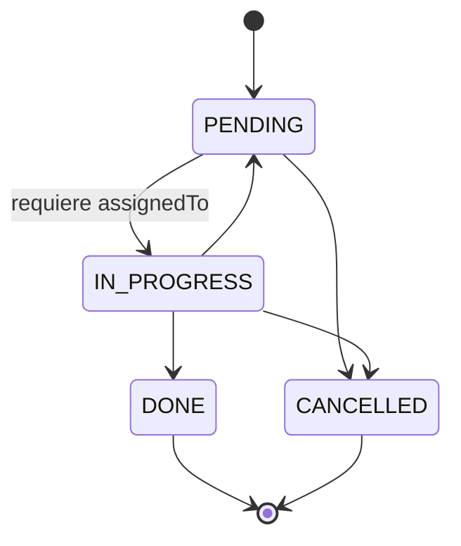

# 01 — Ampliación de la Lógica de Negocio: Máquina de Estados de `Task`

## 1. Motivación

`project-planning.md` define una única regla de transición: *"No se puede cambiar el estado de una tarea `CANCELLED` a otro estado."* Para que las pruebas de cobertura de camino tengan sentido real (para que exista una complejidad ciclomática que valga la pena cubrir con caminos independientes), se amplía la máquina de estados con reglas adicionales, coherentes con un dominio de gestión de tareas real.

**Estas reglas son una propuesta.** Ajústalas si entran en conflicto con una decisión de negocio ya tomada en el proyecto, pero documenta cualquier cambio respecto a lo especificado aquí.

## 2. Diagrama de estados



`DONE` y `CANCELLED` son **estados terminales**: ninguna transición sale de ellos.

## 3. Reglas de negocio (ampliadas)

| # | Regla | Origen |
|---|---|---|
| 1 | Una tarea `CANCELLED` no puede cambiar a ningún otro estado. | Regla original del proyecto |
| 2 | Una tarea `DONE` no puede cambiar a ningún otro estado (es terminal, igual que `CANCELLED`). | Propuesta nueva |
| 3 | No se permite una transición de un estado a sí mismo (ej. `PENDING → PENDING`). Se trata como transición inválida, no como no-op silencioso. | Propuesta nueva |
| 4 | No se puede pasar de `PENDING` directamente a `DONE`; toda tarea debe pasar por `IN_PROGRESS`. | Propuesta nueva |
| 5 | Para pasar de `PENDING` a `IN_PROGRESS`, la tarea debe tener `assignedTo` no nulo y no vacío (no se puede iniciar trabajo en una tarea sin asignar). | Propuesta nueva |
| 6 | Desde `IN_PROGRESS` se puede pasar a `PENDING` (pausar/reabrir), `DONE` (completar) o `CANCELLED` (cancelar). | Propuesta nueva (completa lo que faltaba) |

## 4. Matriz de transiciones completa

| Desde \ Hacia | PENDING | IN_PROGRESS | DONE | CANCELLED |
|---|---|---|---|---|
| **PENDING** | ✘ Regla 3 | ⚠ Regla 5 (solo si `assignedTo` presente) | ✘ Regla 4 | ✔ |
| **IN_PROGRESS** | ✔ | ✘ Regla 3 | ✔ | ✔ |
| **DONE** | ✘ Regla 2 | ✘ Regla 2 | ✘ Regla 2 y 3 | ✘ Regla 2 |
| **CANCELLED** | ✘ Regla 1 | ✘ Regla 1 | ✘ Regla 1 | ✘ Regla 1 y 3 |

## 5. Componente a implementar

Crea un componente dedicado — no mezcles esta lógica dentro del controller ni la dejes solo como un `if` disperso en el service. Esto es consistente con el **Strategy Pattern** que `project-planning.md` ya menciona en la sección de patrones de diseño para "validaciones de transición de estado".

**Ubicación sugerida:** `com.example.taskmanager.service.validation.TaskStatusTransitionValidator`

**Contrato sugerido:**

```java
public interface TaskStatusTransitionValidator {
    void validate(TaskStatus currentStatus, TaskStatus newStatus, String assignedTo);
}
```

- Lanza `InvalidTaskStateException` (ya definida en el proyecto) cuando la transición no es válida.
- El mensaje de la excepción debe indicar con claridad el estado origen, el estado destino y, si aplica, la razón específica (ej. "falta assignedTo para iniciar la tarea").
- Inyéctalo por constructor en `TaskServiceImpl` (no uses `@Autowired` en campo, según la convención ya definida en el proyecto).

**Puntos de integración obligatorios:**

1. `PATCH /api/tasks/{id}/status` — debe invocar el validador antes de persistir el cambio.
2. `PUT /api/tasks/{id}` — si el `status` del payload es distinto al actual, también debe pasar por el validador. **Esto es importante:** no dejes que una actualización completa (`PUT`) pueda saltarse la regla de transición que sí aplica en el `PATCH`.

## 6. Fuera de alcance

- No agregues nuevos campos a la entidad `Task` (ej. "razón de cancelación") — la regla 5 usa el campo `assignedTo` que ya existe.
- No cambies el nombre de los valores del enum `TaskStatus`.
- No implementes notificaciones, auditoría, ni historial de cambios de estado — el alcance es solo la validación y sus pruebas.
