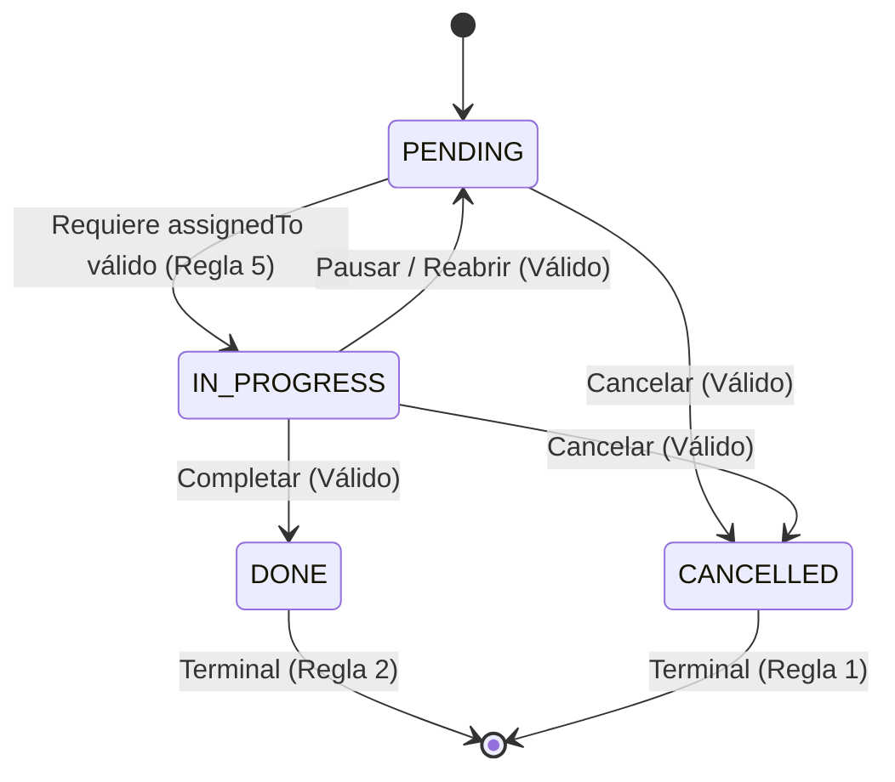

# Guía Definitiva: Pruebas de Transición de Estado y Cobertura de Caminos

> **Proyecto:** Task Manager API  
> **Tecnologías:** Java 17, Spring Boot 3.3.0, JUnit 5, Mockito, Spring Data JPA, H2 Database, JaCoCo.

---

## 1. Fundamentos Teóricos: Caja Negra vs. Caja Blanca

| Criterio | Pruebas de Transición de Estado | Pruebas de Cobertura de Caminos (Basis Path Testing) |
|---|---|---|
| **Tipo de Técnica** | **Caja Negra (Black-Box)** | **Caja Blanca (White-Box)** |
| **Punto de Partida** | Requerimientos de negocio, diagramas de estado y matrices de transición. | Estructura interna del código, ramas de control y bytecode compilado. |
| **Objetivo** | Validar que el ciclo de vida del objeto cumpla las reglas funcionales (permitir transiciones válidas y rechazar inválidas). | Garantizar que cada camino independiente del código y cada rama booleana se ejecute al menos una vez. |
| **Métrica Clave** | Cobertura de celdas de la matriz de transición ($4 \times 4 = 16$ celdas + variantes de condición). | **Complejidad Ciclomática de McCabe $V(G)$** y Cobertura de Ramas (**Branch Coverage** en JaCoCo). |
| **Complementariedad** | Encuentra errores en las reglas del negocio (omisiones funcionales). | Encuentra errores de implementación (código inalcanzable, condiciones de cortocircuito invertidas o no ejercitadas). |

---

## 2. Dominio del Negocio y la Máquina de Estados

La entidad `Task` maneja cuatro estados definidos en el enum `TaskStatus`:
- `PENDING` (Pendiente)
- `IN_PROGRESS` (En progreso)
- `DONE` (Completada - Estado Terminal)
- `CANCELLED` (Cancelada - Estado Terminal)

### Diagrama de Estados


### Las 6 Reglas de Negocio
1. **Regla 1:** Una tarea en estado `CANCELLED` es terminal; no puede cambiar a ningún otro estado.
2. **Regla 2:** Una tarea en estado `DONE` es terminal; no puede cambiar a ningún otro estado.
3. **Regla 3:** No se permite transicionar de un estado a sí mismo (ej. `PENDING` $\to$ `PENDING`). Debe rechazarse explícitamente.
4. **Regla 4:** No se puede pasar de `PENDING` directamente a `DONE`; obligatoriamente debe pasar por `IN_PROGRESS`.
5. **Regla 5:** Para pasar de `PENDING` a `IN_PROGRESS`, el campo `assignedTo` debe existir y no estar en blanco.
6. **Regla 6:** Desde `IN_PROGRESS` se permite transicionar a `PENDING`, `DONE` y `CANCELLED`.

### Matriz Completa de Transiciones ($4 \times 4$)

| Desde \ Hacia | `PENDING` | `IN_PROGRESS` | `DONE` | `CANCELLED` |
|---|---|---|---|---|
| **`PENDING`** | ❌ Rechaza (Regla 3) | ⚠️ Acepta solo si `assignedTo` no es nulo ni vacío (Regla 5) | ❌ Rechaza (Regla 4) | ✔️ Acepta |
| **`IN_PROGRESS`** | ✔️ Acepta | ❌ Rechaza (Regla 3) | ✔️ Acepta | ✔️ Acepta |
| **`DONE`** | ❌ Rechaza (Regla 2) | ❌ Rechaza (Regla 2) | ❌ Rechaza (Regla 2 y 3) | ❌ Rechaza (Regla 2) |
| **`CANCELLED`** | ❌ Rechaza (Regla 1) | ❌ Rechaza (Regla 1) | ❌ Rechaza (Regla 1) | ❌ Rechaza (Regla 1 y 3) |

---

## 3. Código Fuente Bajo Prueba: `TaskStatusTransitionValidator.java`

Ubicación: `src/main/java/com/example/taskmanager/service/validation/TaskStatusTransitionValidator.java`

```java
1: package com.example.taskmanager.service.validation;
2: 
3: import com.example.taskmanager.exception.InvalidTaskStateException;
4: import com.example.taskmanager.model.TaskStatus;
5: import org.springframework.stereotype.Component;
6: 
7: import java.util.EnumSet;
8: import java.util.Map;
9: import java.util.Set;
10: 
11: @Component
12: public class TaskStatusTransitionValidator {
13: 
14:     private static final Map<TaskStatus, Set<TaskStatus>> ALLOWED_TRANSITIONS = Map.of(
15:             TaskStatus.PENDING, EnumSet.of(TaskStatus.IN_PROGRESS, TaskStatus.CANCELLED),
16:             TaskStatus.IN_PROGRESS, EnumSet.of(TaskStatus.PENDING, TaskStatus.DONE, TaskStatus.CANCELLED),
17:             TaskStatus.DONE, EnumSet.noneOf(TaskStatus.class),
18:             TaskStatus.CANCELLED, EnumSet.noneOf(TaskStatus.class));
19: 
20:     public void validate(TaskStatus currentStatus, TaskStatus newStatus, String assignedTo) {
21:         if (currentStatus == newStatus) {
22:             throw invalid(currentStatus, newStatus, "una tarea no puede mantener el mismo estado");
23:         }
24: 
25:         if (!ALLOWED_TRANSITIONS.getOrDefault(currentStatus, Set.of()).contains(newStatus)) {
26:             throw invalid(currentStatus, newStatus, "la transición no está permitida");
27:         }
28: 
29:         if (currentStatus == TaskStatus.PENDING
30:                 && newStatus == TaskStatus.IN_PROGRESS
31:                 && (assignedTo == null || assignedTo.isBlank())) {
32:             throw invalid(currentStatus, newStatus, "falta assignedTo para iniciar la tarea");
33:         }
34:     }
35: 
36:     private InvalidTaskStateException invalid(
37:             TaskStatus currentStatus, TaskStatus newStatus, String reason) {
38:         return new InvalidTaskStateException(
39:                 "Transición de estado inválida de " + currentStatus + " a " + newStatus + ": " + reason);
40:     }
41: }
```

### Desglose Línea por Línea
* **Líneas 14-18:** Define la máquina de estados mediante un mapa inmutable. Los estados terminales `DONE` y `CANCELLED` contienen `EnumSet.noneOf`, impidiendo formalmente cualquier transición de salida.
* **Líneas 21-23 (Decisión 1):** Regla 3. Si `currentStatus == newStatus`, interrumpe inmediatamente lanzando `InvalidTaskStateException`.
* **Líneas 25-27 (Decisión 2):** Consulta si `newStatus` pertenece al conjunto de transiciones válidas. Si no, lanza la excepción (cubre Reglas 1, 2 y 4).
* **Líneas 29-33 (Decisiones 3, 4, 5 y 6):** Regla 5. Condicional compuesto con cortocircuito:
  - Evalúa si `currentStatus == PENDING`.
  - Evalúa si `newStatus == IN_PROGRESS`.
  - Evalúa si `assignedTo == null` o `assignedTo.isBlank()`.
* **Línea 34:** Si ninguna condición lanzó excepción, el método termina normalmente (transición aprobada).

---

## 4. Cobertura de Caminos (Basis Path Testing - McCabe)

### Grafo de Flujo de Control (CFG)
En Java, los operadores lógicos `&&` y `||` evalúan con cortocircuito, creando nodos de bifurcación independientes:

```mermaid
flowchart TD
    Start([Inicio: validate]) --> D1{1: currentStatus == newStatus?}
    D1 -- Sí --> E1[Throw: mismo estado - Camino 1]
    D1 -- No --> D2{2: newStatus en ALLOWED_TRANSITIONS?}
    D2 -- No --> E2[Throw: no permitida - Camino 2]
    D2 -- Sí --> D3{3: currentStatus == PENDING?}
    D3 -- No --> OK[Éxito / return - Camino 6]
    D3 -- Sí --> D4{4: newStatus == IN_PROGRESS?}
    D4 -- No --> OK
    D4 -- Sí --> D5{5: assignedTo == null?}
    D5 -- Sí --> E3[Throw: falta assignedTo - Camino 3]
    D5 -- No --> D6{6: assignedTo.isBlank()?}
    D6 -- Sí --> E4[Throw: falta assignedTo - Camino 5]
    D6 -- No --> OK2[Éxito / return - Camino 4]
```

### Cálculo de Complejidad Ciclomática
$$V(G) = \text{Puntos de decisión} + 1 = 5 + 1 = 6 \text{ caminos independientes}$$

### Los 6 Caminos Básicos y su Trazabilidad con los Tests
1. **Camino 1 (Mismo estado):** `currentStatus == newStatus` $\to$ Cubierto por `TC-01`, `TC-07`, `TC-12`, `TC-17`.
2. **Camino 2 (Transición no permitida):** Estado destino no permitido $\to$ Cubierto por `TC-04`, `TC-10`, `TC-14`, etc.
3. **Camino 3 (Inicio sin asignar - nulo):** `PENDING` $\to$ `IN_PROGRESS` con `assignedTo == null` $\to$ Cubierto por `TC-03`.
4. **Camino 4 (Inicio válido con asignación):** `PENDING` $\to$ `IN_PROGRESS` con `assignedTo == "marina"` $\to$ Cubierto por `TC-02`.
5. **Camino 5 (Inicio sin asignar - espacios en blanco):** `PENDING` $\to$ `IN_PROGRESS` con `assignedTo == "   "` $\to$ Cubierto por `TC-18`.
6. **Camino 6 (Otra transición permitida):** `IN_PROGRESS` $\to$ `DONE`, `CANCELLED`, etc. $\to$ Cubierto por `TC-05`, `TC-06`, `TC-08`, `TC-09`.

---

## 5. Implementación del Test Unitario: `TaskStatusTransitionValidatorTest.java`

Ubicación: `src/test/java/com/example/taskmanager/service/validation/TaskStatusTransitionValidatorTest.java`

```java
37:     @ParameterizedTest(name = "{index}: {0} -> {1} (assignedTo={2}) => {3}")
38:     @MethodSource("transitionCases")
39:     @DisplayName("Dado un estado origen, cuando se solicita una transición, entonces el resultado coincide con la regla de negocio")
40:     void shouldRespectTransitionMatrix(
41:             TaskStatus from, TaskStatus to, String assignedTo, boolean expectedValid) {
42:         // Arrange
43:         TaskStatusTransitionValidator validator = new TaskStatusTransitionValidator();
44: 
45:         // Act & Assert
46:         if (expectedValid) {
47:             assertDoesNotThrow(() -> validator.validate(from, to, assignedTo));
48:         } else {
49:             assertThrows(InvalidTaskStateException.class,
50:                     () -> validator.validate(from, to, assignedTo));
51:         }
52:     }
```

### Los 18 Casos de Prueba (`transitionCases`)
```java
91:     private static Stream<Arguments> transitionCases() {
92:         return Stream.of(
93:                 Arguments.of(TaskStatus.PENDING, TaskStatus.PENDING, "juan", false),       // TC-01 (Camino 1)
94:                 Arguments.of(TaskStatus.PENDING, TaskStatus.IN_PROGRESS, "marina", true),  // TC-02 (Camino 4)
95:                 Arguments.of(TaskStatus.PENDING, TaskStatus.IN_PROGRESS, null, false),     // TC-03 (Camino 3)
96:                 Arguments.of(TaskStatus.PENDING, TaskStatus.DONE, "oscar", false),         // TC-04 (Camino 2)
97:                 Arguments.of(TaskStatus.PENDING, TaskStatus.CANCELLED, "ines", true),      // TC-05 (Camino 6)
98:                 Arguments.of(TaskStatus.IN_PROGRESS, TaskStatus.PENDING, "diego", true),   // TC-06 (Camino 6)
99:                 Arguments.of(TaskStatus.IN_PROGRESS, TaskStatus.IN_PROGRESS, "sofia", false), // TC-07 (Camino 1)
100:                Arguments.of(TaskStatus.IN_PROGRESS, TaskStatus.DONE, "raul", true),       // TC-08 (Camino 6)
101:                Arguments.of(TaskStatus.IN_PROGRESS, TaskStatus.CANCELLED, "elena", true), // TC-09 (Camino 6)
102:                Arguments.of(TaskStatus.DONE, TaskStatus.PENDING, "bruno", false),         // TC-10 (Camino 2)
103:                Arguments.of(TaskStatus.DONE, TaskStatus.IN_PROGRESS, "carla", false),     // TC-11 (Camino 2)
104:                Arguments.of(TaskStatus.DONE, TaskStatus.DONE, "mateo", false),            // TC-12 (Camino 1)
105:                Arguments.of(TaskStatus.DONE, TaskStatus.CANCELLED, "valeria", false),     // TC-13 (Camino 2)
106:                Arguments.of(TaskStatus.CANCELLED, TaskStatus.PENDING, "nicolas", false),  // TC-14 (Camino 2)
107:                Arguments.of(TaskStatus.CANCELLED, TaskStatus.IN_PROGRESS, "paula", false),// TC-15 (Camino 2)
108:                Arguments.of(TaskStatus.CANCELLED, TaskStatus.DONE, "tomas", false),       // TC-16 (Camino 2)
109:                Arguments.of(TaskStatus.CANCELLED, TaskStatus.CANCELLED, "ines", false),   // TC-17 (Camino 1)
110:                Arguments.of(TaskStatus.PENDING, TaskStatus.IN_PROGRESS, "   ", false));   // TC-18 (Camino 5)
111:    }
```

---

## 6. Pruebas de Integración y Rol de la Base de Datos H2

Ubicación: `src/test/java/com/example/taskmanager/controller/TaskStatusTransitionControllerIntegrationTest.java`

### ¿Por qué se sabe que la tarea está cancelada?
En el método auxiliar `seedTask`:
```java
66: private void seedTask(Long id, String title, String priority, String assignedTo) {
67:     jdbcTemplate.update(
68:             "insert into tasks (id, title, description, status, priority, assigned_to, "
69:                 + "created_at, updated_at) values (?, ?, null, 'CANCELLED', ?, ?, "
70:                 + "CURRENT_TIMESTAMP, CURRENT_TIMESTAMP)",
71:             id, title, priority, assignedTo);
72: }
```
La columna `status` tiene insertado físicamente el literal `'CANCELLED'` directamente en la base de datos de pruebas.

### ¿Cómo interviene H2?
1. **Configuración en memoria RAM:** `@SpringBootTest(properties = "spring.datasource.url=jdbc:h2:mem:taskdb;MODE=PostgreSQL")` levanta una base de datos en RAM emulando PostgreSQL.
2. **Limpieza (`@BeforeEach`):** Ejecuta `DELETE FROM tasks` para asegurar que cada test sea independiente (principio F.I.R.S.T).
3. **Siembra (`seedTask`):** `JdbcTemplate` escribe la tarea cancelada en H2.
4. **Lectura por JPA:** Cuando `MockMvc` ejecuta el `PATCH /api/tasks/1/status`, `TaskServiceImpl` busca la tarea en H2 vía `taskRepository.findById(1L)`.
5. **Protección:** El validador rechaza la transición de `CANCELLED` a `PENDING`, impidiendo que se ejecute `save()` y protegiendo los datos en H2.
6. **Respuesta HTTP:** `GlobalExceptionHandler` traduce la excepción a HTTP `400 Bad Request`.

---

## 7. Análisis del Reporte JaCoCo

Comando de ejecución:
```bash
./gradlew test jacocoTestReport jacocoTestCoverageVerification
```

### Resultados Obtenidos en `build/reports/jacoco/test/html/index.html`
* **Instrucciones:** 70 de 70 cubiertas (**100%**).
* **Ramas (Branches):** 12 de 12 cubiertas (**100%**).
* **Complejidad Ciclomática (Cxty):** 10 total (7 en el método `validate`).

### Significado de los Colores e Íconos en el Reporte
* 🟩 **Fondo Verde:** Línea de código completamente ejecutada.
* 🟢 **Diamante Verde (`All branches covered`):** Todas las decisiones booleanas (`true` y `false`) de ese condicional fueron evaluadas en los tests.
* 🟨 **Fondo Amarillo / Diamante Amarillo:** Cobertura parcial (al menos una rama quedó sin probar).
* 🟥 **Fondo Rojo / Diamante Rojo:** Código nunca alcanzado.

### Verificación de Reglas en `build.gradle`
* `service.validation.*` $\to$ Requiere mínimo `0.90` (90%) en `BRANCH`. **Obtuvo 100% (12/12)**.
* `service.impl.*` $\to$ Requiere mínimo `0.80` (80%) en `INSTRUCTION`. **Obtuvo 95% (253/266)**.
* Como se cumplieron todas las reglas, Gradle retornó código de salida **`0` (BUILD SUCCESSFUL)**.
